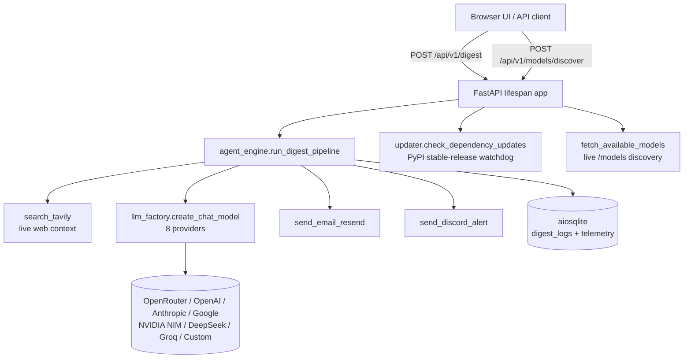

# PulseDigest AI


**PulseDigest AI** is an open-source, cloud-native, zero-GPU autonomous microservice that
searches live web sources on any topic, synthesizes a cited executive digest with any major
cloud LLM, dispatches alerts via Email (Resend) and Discord, tracks token costs in async
SQLite, and monitors its own Python dependencies for stable updates.

## Architecture



## Key Features

- **Universal Cloud LLM Router** — `openrouter`, `openai`, `anthropic`, `google`,
  `nvidia_nim`, `deepseek`, `groq`, or `custom` (any OpenAI-compatible `base_url`).
  Default fallback model: `openrouter/auto` (auto-routing — no deprecated ids hardcoded).
- **Live Model Discovery** — with a provider + API key, the backend queries the provider's
  `/models` endpoint live (OpenAI-compatible `Bearer` auth for seven providers; native
  Anthropic `x-api-key` + `anthropic-version` headers) and returns the current,
  non-deprecated model catalog so the UI dropdown is always up to date. OpenRouter keys are
  additionally verified against `/api/v1/auth/key` (its public `/models` list ignores bad
  tokens), so a dead key fails during discovery instead of mid-digest.
- **Autonomous Digest Pipeline** — Tavily search → noise-filtering LLM synthesis with
  sections *Key Takeaways / Deep Dive / Sources* and bracketed citations.
- **Language Mirroring (or a Forced Target)** — `output_language: "auto"` (default) makes
  the model write the whole report — headings included — in the topic's own language
  (Persian topic → `## نکات کلیدی`, `## تحلیل عمیق`, `## منابع`). Explicit values such as
  `Persian`, `English`, `Arabic`, `German`, `French` (or `fa`, `en`, ...) always win.
- **Multi-Channel Dispatch** — Resend email + Discord embeds through `asyncio.gather`;
  every channel degrades gracefully (`sent: false`, never a crash) when unconfigured.
- **Async Token Telemetry** — per-request tokens, latency, and estimated USD cost in
  `aiosqlite`; surfaced as aggregates at `/api/v1/stats`.
- **Self-Updating Watchdog** — compares installed `importlib.metadata` versions against
  PyPI latest *stable* releases (pre-releases `rc/b/a/dev` excluded) and alerts Discord.
- **Premium Web Console** — glassmorphism dashboard with a **day/night theme toggle**
  (persisted in `localStorage`), a **per-provider** browser key vault with an active-key
  badge, live model search + quick filters, animated pipeline progress, and a styled
  Markdown reader with copy/download and delivery pills.
- **Actionable Error Envelope** — upstream LLM failures return `{"detail": ...}` with the
  right status (`401` bad key, `400` model/data-policy, `429` rate limit, `502` network),
  never an opaque `500`.

## Key Hygiene & Precedence

Every secret passes through the same sanitizer (`config.sanitize_secret`):

1. Leading/trailing whitespace **and quotes** are stripped — pasting `"sk-..."` works.
2. Placeholder values are treated as *unset*: anything containing `your_`, `changeme`,
   `change_me`, `sk-xxx`, `tvly-xxx`, `re_xxx`, `placeholder`, `example` or `<`.
   This is what prevents `.env` scaffolding from being sent upstream as a bearer token
   and producing `401 User not found`.
3. Per-request/UI keys always beat `.env` keys. A placeholder override falls back to the
   real `.env` value instead of masking it.
4. `.env` is **live-reloaded**: `get_settings()` stats the file on every call and rebuilds
   the cached settings when it changed, so pasting a new key while `uvicorn` runs takes
   effect on the next request — no restart. Real process env vars still win over the file.
5. `/api/v1/providers` exposes booleans (`env_status`) plus masked fingerprints
   (`env_fingerprints`, e.g. `sk-or-v…4a2b`) — never the secret strings. Upstream `401`s
   name the exact key in use (`UI Override` vs `Server .env`) and its fingerprint.

## Web Console Guide

- **Day / Night theme** — the header toggle switches the whole console (and the Markdown
  reader) between the dark canvas and a low-glare **muted-slate** light theme (`#DCE3EC`
  canvas, slate-100 cards, `#E8EEF5` fields — no pure-white glare); the choice persists in
  `localStorage` and is applied before first paint.
- **Model Router** — pick one of 8 providers, paste a key (saved **per provider** in
  `localStorage`, so an NVIDIA key is never sent to OpenRouter), add a custom base URL when
  provider is `custom`, then **Discover Live Models**. The line under the key box shows
  `Active key: UI Override (sk-or-…4a2b)` or `Active key: Server .env (…)` with a
  **× Use server .env instead** action.
- **Live model search** — filter the discovered catalog instantly by name/ID or with the
  `All / ⚡ Free / GPT / Claude / Gemini / DeepSeek / Llama` chips; the counter shows
  `Showing X of Y models` and the first match is auto-selected.
- **Integrations & API Keys** — Tavily (`tvly-...`), Resend (`re_...`) + from-email and a
  Discord webhook, each with a badge showing whether the server `.env` already has it.
  **Save keys** persists to this browser; **Clear saved keys** wipes them.
- **New Digest** — topic (`dir="auto"` for Persian/Arabic), **Output language** selector
  (`🌐 Auto (Same as Topic Language)` default, plus Persian/English/Arabic/German/French),
  recipient email, Email and Discord toggles, then **Run autonomous digest** with a
  three-step progress indicator.
- **Result reader** — sanitized Markdown (`marked` + `DOMPurify`), latency, token
  breakdown, USD cost, delivery pills, **Copy Markdown** and **Download .md**.

## Quickstart

```bash
# 1. Clone & enter the project
git clone <your-repo-url> pulsedigest-ai && cd pulsedigest-ai

# 2. Create a virtual environment (Python 3.13+)
python -m venv venv
source venv/bin/activate          # Windows: venv/Scripts/activate

# 3. Install dependencies
pip install -r requirements.txt

# 4. Configure
cp .env.example .env              # then fill in the keys you need

# 5. Run
uvicorn main:app --reload
# → http://localhost:8000  (day/night console)
# → http://localhost:8000/docs  (OpenAPI UI)
```

### Environment variables

| Variable | Purpose |
| --- | --- |
| `DEFAULT_LLM_PROVIDER` / `DEFAULT_LLM_MODEL` | Global defaults (`openrouter` / `openrouter/auto`) |
| `OPENROUTER_API_KEY`, `OPENAI_API_KEY`, `ANTHROPIC_API_KEY`, `GOOGLE_API_KEY`, `NVIDIA_NIM_API_KEY`, `DEEPSEEK_API_KEY`, `GROQ_API_KEY` | One key per provider you use |
| `CUSTOM_LLM_API_KEY`, `CUSTOM_LLM_BASE_URL` | For the `custom` provider |
| `TAVILY_API_KEY` | Live web search (absent → mock fallback) |
| `RESEND_API_KEY`, `RESEND_FROM_EMAIL` | Email dispatch |
| `DISCORD_WEBHOOK_URL` | Discord dispatch |
| `DB_PATH` | SQLite database file (default `pulsedigest.db`) |

Only the keys you need must exist — everything else degrades gracefully.

## API Endpoints

| Method | Path | Description |
| --- | --- | --- |
| `GET /` | Dashboard | Single-page day/night console |
| `POST /api/v1/digest` | Run digest | Topic + `output_language` + optional provider/model/email/discord flags and integration overrides → `DigestResponse` |
| `POST /api/v1/models/discover` | Live discovery | `{provider, api_key_override?, custom_base_url?}` → `ModelDiscoveryResponse` (`models: ModelInfo[]`); OpenRouter keys are validated first |
| `GET /api/v1/providers` | Providers | Supported providers, defaults, `env_status` booleans and masked `env_fingerprints` |
| `GET /api/v1/stats` | Telemetry | Requests, tokens, USD cost, per-provider split |
| `GET /api/v1/system/check-updates` | Watchdog | Installed vs latest stable PyPI versions |

Example:

```bash
curl -X POST http://localhost:8000/api/v1/models/discover \
  -H 'Content-Type: application/json' \
  -d '{"provider": "openai", "api_key_override": "sk-..."}'
```

Run a digest with per-request integration credentials (UI vault equivalents):

```bash
curl -X POST http://localhost:8000/api/v1/digest \
  -H 'Content-Type: application/json' \
  -d '{
        "topic": "open-weight LLMs in 2026",
        "output_language": "auto",
        "recipient_email": "team@company.com",
        "notify_email": true,
        "notify_discord": true,
        "llm_config": {"provider": "openrouter", "model_name": "openrouter/auto"},
        "integrations_config": {
          "tavily_api_key": "tvly-...",
          "resend_api_key": "re_...",
          "resend_from_email": "onboarding@resend.dev",
          "discord_webhook_url": "https://discord.com/api/webhooks/..."
        }
      }'
```

`tavily_api_key`, `resend_api_key`, `resend_from_email` and `discord_webhook_url` are also
accepted as flat fields on the same payload (flat fields win over the nested object).

`output_language` accepts `auto` (mirror the topic language, default), a language name
(`Persian`, `English`, `Arabic`, `German`, `French`, ...) or an ISO code (`fa`, `en`, `ar`,
`de`, `fr`). The report and all three section headings are written in that language.

### Error responses

| Status | Meaning |
| --- | --- |
| `400` | Missing provider key, rejected model, or data-policy/region block |
| `401` | Upstream provider rejected the API key (detail names the key source + masked fingerprint) |
| `429` | Provider rate limit hit |
| `502` | Upstream timeout or network failure |

Every error is `{"detail": "actionable message with provider context"}`.

## Testing

```bash
ruff check .          # zero lint errors required
pytest -v             # full suite, network fully mocked
```

## License

MIT — see the repository for details.
